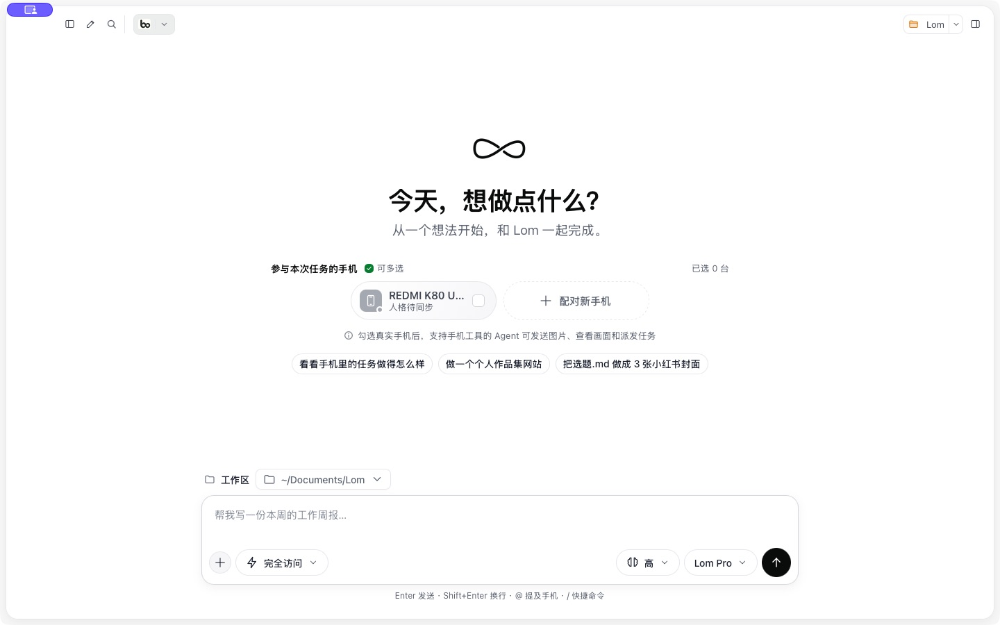
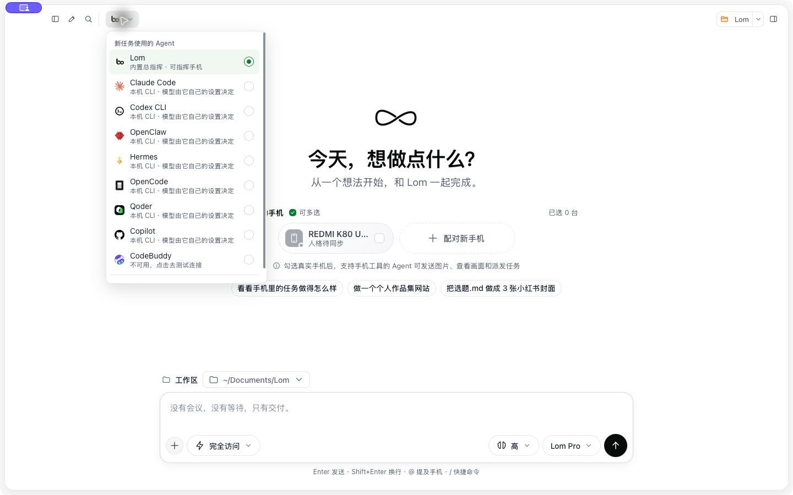

<div align="center">

# Lom (麓鸣)

**A desktop AI workspace where one commander leads computer agents (Codex, Claude Code, Gemini CLI and more) and Android phone agents as a single team.**

**麓鸣 Lom 是桌面 AI 工作台：一个总指挥带多个电脑 Agent（Codex、Claude Code、Gemini CLI 等）和 Android 手机 Agent 协作。**

[Website](https://lom.entermodetwo.com/en/) · [简体中文](README.zh-CN.md) · [Docs](https://lom.entermodetwo.com/en/docs/) · [Download](https://lom.entermodetwo.com/en/#download) · [Phone agent integration](https://lom.entermodetwo.com/docs/phone-access/)

[](https://lom.entermodetwo.com/en/)
[](LICENSE)
[](https://lom.entermodetwo.com/en/#download)
[](https://github.com/rfdiosuao/lom-desktop/stargazers)



</div>

## What Lom does

Lom runs on your computer and acts as the commander. You state a goal; Lom splits it up, hands each part to the right agent, reads back the real results and reports to you. Payments, orders, posts and direct messages are always confirmed with you first.

- **Computer agents.** Work with the agent CLIs installed on your machine, such as Codex CLI, Claude Code, Gemini CLI, Kimi, Qwen and OpenCode. Lom detects what is installed; each agent keeps using its own model and login.
- **Phone agents.** Pair Android phones by QR code. The official Lom phone app and the third-party Mika (Lom edition) can both take work from the desktop, and the pairing protocol is public, so you can build your own phone app (see [phone agent integration](docs/open/phone-access/README.md)).
- **Personal assistant.** An assistant with its own conversation and memory that can run scheduled tasks and hand work to your OPC team. Having Jev manage its context is coming soon.
- **OPC team group chat.** Since desktop 0.3.8, mention the team leader in one timeline and watch tasks being dispatched and reported back. Phone members in the group chat are coming soon.
- **Skills and MCP.** A skills marketplace, MCP servers, slash commands and four permission levels per task.

<p align="center"></p>

> The list above describes the official Lom release. This repository is the community source: it does **not** include the commercial account, credits, model gateway or cloud pairing relay, so features that depend on those services are not available in a community build (see below).

## Download

Official installers for macOS (Apple silicon) and Android are on the website: **<https://lom.entermodetwo.com/en/#download>**. The Windows version is not available yet.

## Quick start

For the official app, install it from the website and follow the [quick start guide](https://lom.entermodetwo.com/en/docs/). To build from this source:

```sh
cd apps/desktop
npm ci
npm run typecheck
npm test -- --maxWorkers=2
npm run build
```

The local Rust core, the Tauri shell and the Android app have their own toolchains; see [BUILDING.md](BUILDING.md).

## About this repository

This repository contains the desktop client, local execution core, Android client, and device protocol source in one place. It is a source distribution for community development, without the commercial account, billing, model gateway, cloud pairing relay, operations console, or deployment services. The community desktop and Android client can pair over a local network by QR; LAN messages use signed encrypted envelopes.

**It does not connect to an official Lom cloud by default.** Configure your own model provider for ordinary desktop tasks. Account-dependent Personal Agent features still require a compatible service, but desktop-to-phone LAN pairing is implemented locally: the desktop hosts a one-time QR session and the phone connects directly on the same private network. The Android app also retains its local features and protocol source. Its upstream developer debug server is not a replacement for Lom LAN pairing.

LAN pairing is intended for a trusted private network. Pairing and control HTTP traffic is cleartext and uses a one-time QR secret plus a bearer device token; remote RPC payloads are signed encrypted envelopes. Do not expose the LAN port to the internet or an untrusted network.

### Source layout

| Directory | Contents | License |
| --- | --- | --- |
| `apps/desktop` | React/TypeScript UI and Tauri desktop shell | AGPL-3.0-only |
| `core` | Local Rust execution core, based on AionCore | Apache-2.0; see component notices |
| `apps/android` | Mobile source based on OpenMinis; Lom changes target Android | GPL-3.0; see third-party licenses |
| `protocol` | Device schema, generated bindings and test vectors | MIT OR Apache-2.0 |

These are separate programs communicating through protocols, not a relicensing of their components. Preserve each component's notices when redistributing. The included iOS source is upstream material, not a claim that Lom iPhone pairing is supported.

See [the source snapshot record](docs/SOURCE_SNAPSHOTS.md) and [release boundaries](docs/OPEN_SOURCE_SCOPE.md). Private Git histories and commercial server sources are not imported. Historical public commits remain available in this repository's Git history.

Before publishing changes, run `python3 tools/audit-source.py` and the relevant component tests. The audit reports paths/rule names only and never prints matching secret values. It is one review layer, not a guarantee that source is free of every possible sensitive datum.

## Documentation

- [Website documentation](https://lom.entermodetwo.com/en/docs/): quick start, phone setup, desktop features, OPC teams, FAQ and changelog.
- [Phone agent integration](docs/open/phone-access/README.md) ([website version](https://lom.entermodetwo.com/docs/phone-access/)): QR and deep link format, pairing, identity keys, relay, encrypted envelope, RPC methods and test vectors. Enough to build a phone app that pairs with Lom Desktop without touching any private code.
- [BUILDING.md](BUILDING.md), [CONTRIBUTING.md](CONTRIBUTING.md), [SECURITY.md](SECURITY.md).

## Acknowledgements

Lom builds on open source work, and we are grateful to the authors and contributors of:

- [AionUi](https://github.com/iOfficeAI/AionUi): the desktop core is built on it.
- [OpenMinis](https://github.com/OpenMinis/OpenMinis): the Android client is built on it.
- [Mika](https://github.com/wangzan101/Mika) by wangzan101 (Apache-2.0): the third-party phone agent that the Lom edition is based on. The Lom edition is not released by the original author and does not speak for them.

## License

Licensing is per component, see the table above and each component's notices. The desktop UI and shell are AGPL-3.0-only; see [LICENSE](LICENSE).
