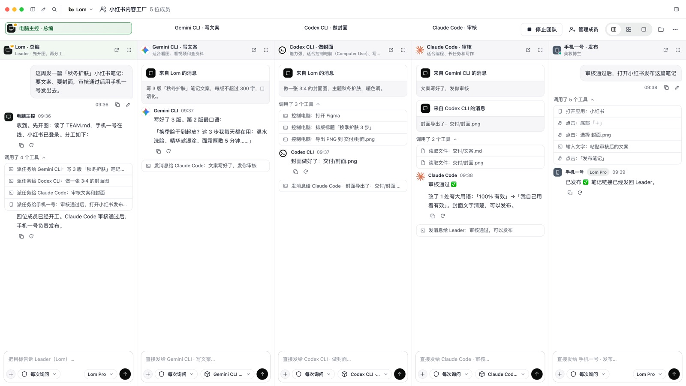
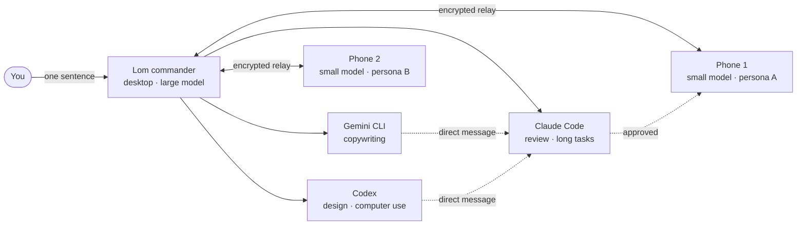
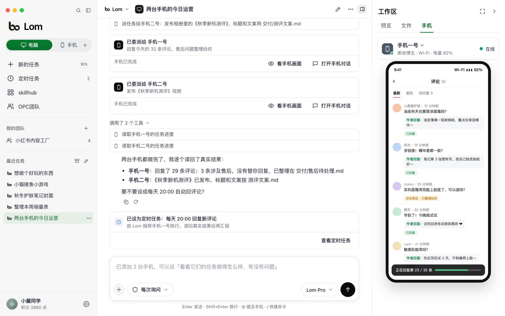
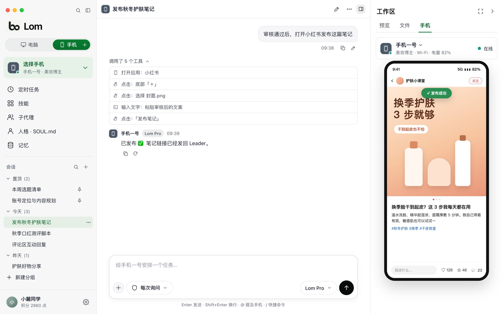
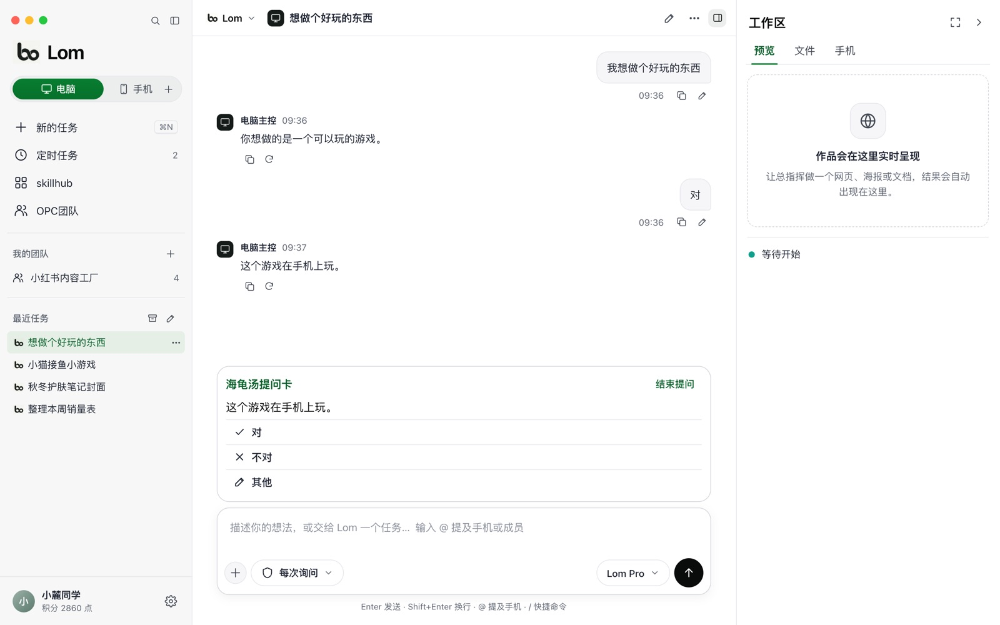
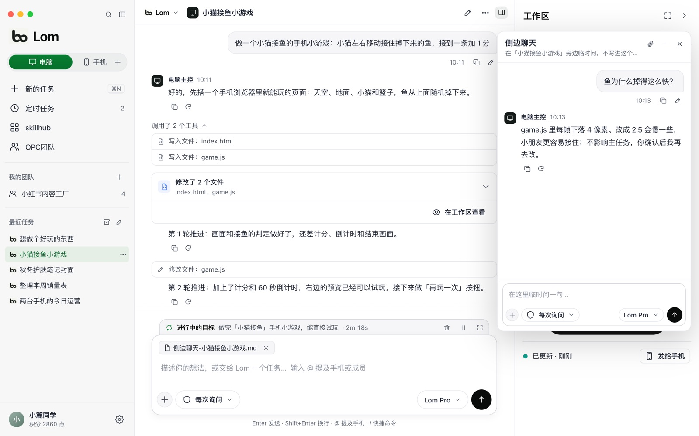
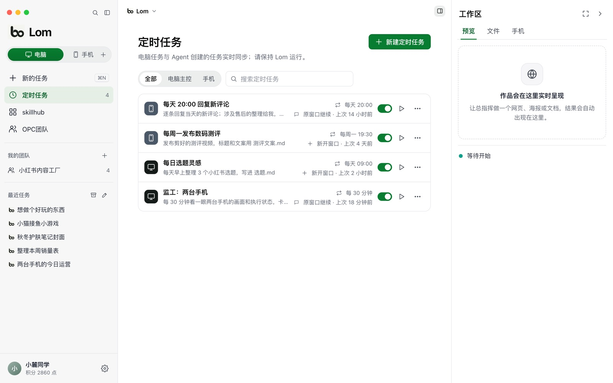

<p align="center">
  <a href="https://lom.entermodetwo.com/en/"></a>
</p>

<h1 align="center">Lom</h1>

<p align="center">
  <b>Your computer is the commander. Your phones do the work.</b><br>
  An AI agent workspace for one-person companies. One desktop commander leads Codex, Claude Code, Gemini CLI and your Android phones as a single team.
</p>

<p align="center">
  <a href="https://github.com/rfdiosuao/lom-desktop/releases/latest"></a>
  
  
  
  <a href="LICENSE"></a>
  <a href="https://github.com/rfdiosuao/lom-desktop/stargazers"></a>
</p>

<p align="center">
  <a href="https://lom.entermodetwo.com/en/">Website</a> ·
  <a href="https://github.com/rfdiosuao/lom-desktop/releases/latest">Download</a> ·
  <a href="https://lom.entermodetwo.com/en/#video">Watch the 2½-minute demo</a> ·
  <a href="https://lom.entermodetwo.com/en/docs/">Docs</a> ·
  <a href="README.zh-CN.md">中文</a>
</p>

<p align="center">
  
</p>
<p align="center"><sub>One sentence, five teammates: Gemini CLI writes the copy, Codex designs the cover, Claude Code reviews it, and a phone publishes the post. (Interface in Chinese, demo data.)</sub></p>

---

## Why Lom

One-person companies are booming. A single founder now does the work of a writer, a designer, an editor, a social media manager and a support desk. AI on the computer can already write, design and code. But the audience and the sales live inside phone apps, and those apps offer individuals almost no API. Phone assistants, for their part, help one person run one errand on one phone.

Lom closes that gap. The commander on your computer turns an idea into finished work, then hands it to phones that publish it, answer comments and run the daily operations. It works on any network and keeps working after you go to bed.

> A phone assistant makes one phone smarter. Lom turns a drawer of old phones into your staff.

## How it works



- **You** talk to one commander.
- **The commander** runs on your computer with a large model. It reads the whole picture first, then splits the work.
- **Desktop agents** such as Codex, Claude Code and Gemini CLI join as teammates and message each other directly.
- **Phones** are independent agents on cheap small models, each with its own persona, skills, memory and schedule. They connect through an end-to-end encrypted cloud relay, so they can be anywhere.

## What Lom can do

### A desktop commander that ships finished work

- Works inside a folder you choose: writes files and builds web pages, posters, copy and video scripts, with a **live preview** next to the chat.
- Runs install commands (npm, pip, brew, winget and others) to set up the tools it needs. Every step follows your permission mode.
- **Goals** that keep going: set a goal and Lom keeps working on it until it is done.
- **Side chat**: ask a quick question in a floating window without derailing the main task, then drag the conversation back in as an attachment.
- Slash commands for memory, goals, compaction, archiving and reasoning effort. It also understands images and remembers what matters across conversations.
- Pick the model per conversation from the model menu.

### Phones as teammates

- **Pair in seconds.** Scan a QR code shown on the desktop with the Lom Agent app, or type a pairing code. The phone never signs in; it simply joins your account.
- **No cable, no shared Wi-Fi, no developer mode.** Desktop and phone talk through an end-to-end encrypted cloud relay, so a phone on 4G/5G across town works just like one on your desk.
- **Every phone is its own agent** with a persona (`SOUL.md`), skills, memory, sub-agents, conversations and scheduled tasks. All of them sync both ways with the desktop.
- **See and steer.** The workspace panel shows the phone's live screen. The commander can read the screen and its UI structure, tap, swipe, type, go back or home, and open apps.
- **Delegate and verify.** The commander hands a task to the phone's own agent and reads back the real result. A task only counts as done when the phone reports it complete.
- **Send files to the phone**, for example a finished video saved to the gallery, ready to post.

<p align="center">
  
</p>
<p align="center"><sub>"Today's operations for both phones": Phone 1 replies to 32 comments, Phone 2 publishes a video, the commander reads back both results and makes it a daily 20:00 task. (Demo data.)</sub></p>

### OPC teams: agents that talk to each other

- Build a team for your one-person company: name the roles and set each one's duties, prompt and tools.
- **Lom leads.** It plans first, then assigns work by strength.
- **Members can be desktop agents or phones.** Codex, Claude Code, Gemini CLI, Kimi, CodeBuddy and more are detected automatically. They use their own CLI sign-in and models, so they don't spend Lom credits.
- **Direct messages between members.** The writer sends drafts to the reviewer, and the reviewer clears them for the publisher. Nothing has to go through the leader. Every member has its own pane, and you can talk to any of them.

### Turtle-soup questions: clarity before work

*Turtle soup* (海龟汤) is a yes/no guessing game. Lom turns it into a requirements tool. Instead of asking open questions, the agent offers short statements and you tap **Yes** or **No**. A few rounds turn "I want to make something fun" into a precise brief. It is how we teach kids and first-time users to work with AI.

### Scheduled tasks that run while you sleep

- Pick who runs it (the commander or a specific phone), write one sentence and set a schedule. Each run can continue the same conversation or open a new one.
- Phone tasks live on the phone and **keep running even when your computer is off**.
- The commander can schedule its own check-ins, for example looking at every phone's screen and progress every 30 minutes.

### skillhub

A skill marketplace. Install skills on the commander or push them to a single phone. Skills turn repeatable workflows into one-click capabilities: publishing, replying to comments, collecting lists, syncing spreadsheets, generating images and videos.

### Models and pricing

- **Free to download and use.** Built-in models (Lom Mini, Pro and Max) run on credits, and new accounts get free credits. Top up or subscribe for more credits and more phones.
- Bring your own API key if you prefer.
- **Big and small models split the work.** Phones handle daily tasks on small, inexpensive models, and the commander's large model steps in only when it is needed.

### Security by design

- Desktop and phones only make outbound connections to the relay. Neither opens a port.
- End-to-end encryption: keys are exchanged during pairing, and the relay forwards ciphertext it cannot read.
- Remote control is limited to a fixed set of actions (tap, swipe, type, back, home, open app) and never runs arbitrary commands. Retried commands are de-duplicated, so nothing happens twice.
- The phone keeps an action log without typed text or screenshots.
- Honest status: offline, unauthorized and failed states are shown as they are. Secure windows such as payments and banking are reported as failures, never bypassed.

## Use cases

| Who | A day with Lom |
|---|---|
| **Content studio** | Gemini CLI drafts three versions of a post, Codex designs the cover, Claude Code removes risky wording. Phone 1 posts the note, Phone 2 posts the video, and at 20:00 both reply to new comments while after-sales questions are collected for you. |
| **Small online shop** | Drop product photos into a folder. The commander writes titles, descriptions and selling-point images with a live preview. A phone lists the product in the seller app, another answers routine questions twice a day and flags the rest, and a nightly summary lands in your spreadsheet. |
| **Indie developer** | Codex builds the feature and Claude Code reviews it. The build goes to two phones, one on Wi-Fi and one on 4G, which install it and walk through a test checklist. Screenshots come back to the commander, which files the bugs for Codex. |
| **AI tutor and creator** | A child says "I want to make something fun". Turtle-soup cards narrow it down, and the commander builds a small game they can play right away. The lesson becomes a short video that a phone publishes, with follow-up questions answered on a schedule. |

## How Lom is different

| | Computer agents | Phone assistants | Scripted phone farms | **Lom** |
|---|---|---|---|---|
| Reaches phone apps | No | One phone, vendor allow-list | Yes | **Yes, any network, QR pairing** |
| Produces real work | Strong | Light | No | **Strong: large model plus coding agents** |
| Many devices | — | No | Same script on every device | **Each phone is its own agent with a role** |
| Runs on a schedule | Varies | On request | Yes | **Yes, even with the computer off** |
| What you need | A computer | A new phone | Racks of phones | **Your computer and phones you already own** |

## Screenshots

<table>
  <tr>
    <td width="50%"><br><sub><b>Phone mode.</b> Talk to one phone's agent; its persona, skills, memory and schedule are in the sidebar.</sub></td>
    <td width="50%"><br><sub><b>Turtle-soup card.</b> Answer Yes or No until the brief is clear.</sub></td>
  </tr>
  <tr>
    <td width="50%"><br><sub><b>Side chat.</b> Ask aside, then drop the result into the main task.</sub></td>
    <td width="50%"><br><sub><b>Scheduled tasks.</b> Daily replies, weekly posts and a commander check-in every 30 minutes.</sub></td>
  </tr>
</table>

## Download

| Platform | Requirements | Get it |
|---|---|---|
| **macOS** | macOS 11 or later, Apple silicon | `.dmg` from [Releases](https://github.com/rfdiosuao/lom-desktop/releases/latest) |
| **Windows** | Windows 10 or 11, 64-bit | `.exe` installer from [Releases](https://github.com/rfdiosuao/lom-desktop/releases/latest) |
| **Android** (Lom Agent) | Android 8 or later; live screen needs Android 11+ | `.apk` from the [website](https://lom.entermodetwo.com/en/#download) |

First launch:

- **macOS:** the app is not notarized yet, so macOS may say it "is damaged and can't be opened", that it cannot verify the developer, or simply do nothing. Drag Lom into Applications, open Terminal, run this line, then open Lom again:

  ```bash
  xattr -dr com.apple.quarantine "/Applications/麓鸣 Lom.app"
  ```

  It only removes the download quarantine flag and needs no password. If it says `Permission denied`, run it again with `sudo` in front. You can also use System Settings → Privacy & Security → **Open Anyway**.
- **Windows:** if SmartScreen shows "Windows protected your PC", choose **More info → Run anyway**. If there is no such button or the installer does nothing, open a terminal in your Downloads folder and run:

  ```powershell
  Unblock-File .\Lom-*-windows-x64-setup.exe
  ```

  Or right-click the installer → Properties → tick **Unblock**. The installer works per user and needs no admin rights.

Getting started:

1. Install Lom and sign in with a HEANG, Google or GitHub account.
2. Click **+ → Add phone** and scan the QR code with the Lom Agent app on your phone.
3. On the phone, turn on accessibility for Lom Agent ([phone setup guide](https://lom.entermodetwo.com/en/docs/phone.html)).
4. Tell the commander what you want done.

## Roadmap

- [ ] Phones ask the commander for help; the commander takes over, then hands control back, fully automatically
- [ ] One-click supervision rounds for every phone
- [ ] Live phone screen as a video stream (today it refreshes about once per second)
- [ ] Team templates: content studio, online shop, indie developer
- [ ] skillhub publishing and revenue share for skill creators
- [ ] Protocol-first app integration (MCP), with screen operation as the fallback
- [ ] Intel Macs and more phone platforms

## Principles

- **Real business only.** Your accounts, your content, your comments. No fake engagement and no bulk account farming.
- **No "one command to fifty phones".** Each phone is an agent with its own persona. Bulk work runs through schedules and skills.
- **People confirm sensitive actions.** Platform rules come first, and where an app offers protocol access, Lom uses it.

## Open source, step by step

Lom is opening up module by module. The desktop interface is here under AGPL-3.0, and more modules will follow once they pass a security review. Issues and pull requests are welcome. The installers in [Releases](https://github.com/rfdiosuao/lom-desktop/releases) are the official full builds. More details: [scope](docs/SCOPE.md) · [development](docs/DEVELOPMENT.md) · [third-party notices](docs/THIRD_PARTY.md) · [security](SECURITY.md).

---

<p align="center">
  If Lom helps you run your one-person company, a ⭐ helps others find it.<br>
  <sub>From answering questions to getting work done.</sub>
</p>

## Acknowledgements

Special thanks to these outstanding open-source projects and their maintainers and contributors:

- [AionUi](https://github.com/iOfficeAI/AionUi)
- [OpenMinis](https://github.com/OpenMinis/OpenMinis)

## Build Lom with us

We are opening more desktop UI, native window/file functionality, and local CLI integration under the existing license. Start with the **[community roadmap and unresolved bugs](COMMUNITY_PLAN.md)** and **[contribution guide](CONTRIBUTING.md)**. The roadmap distinguishes public desktop tasks, modules awaiting extraction, and work that requires the maintainers' private services.

The standalone source includes a document workbench, desktop component gallery, and optional local-runtime adapters. It does not yet reproduce every production chat/workspace screen. Mobile, server, commercial model runtime, and account/billing implementations remain private. See the exact [source and release boundaries](docs/SCOPE.md) before building.
