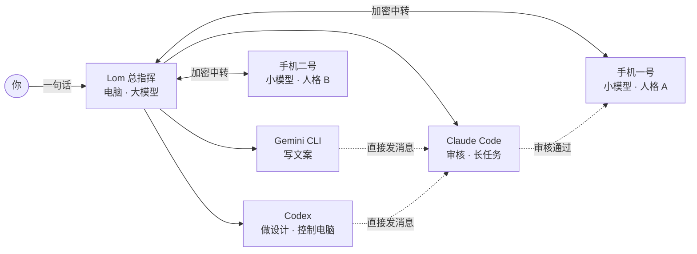

<p align="center">
  <a href="https://lom.entermodetwo.com"></a>
</p>

<h1 align="center">麓鸣 Lom</h1>

<p align="center">
  <b>电脑当总指挥，手机替你干活。</b><br>
  给一人公司用的 AI Agent 工作空间：一个桌面总指挥，带着 Codex、Claude Code、Gemini CLI 和你的安卓手机，组成一支团队。
</p>

<p align="center">
  <a href="https://github.com/rfdiosuao/lom-desktop/releases/latest"></a>
  
  
  
  <a href="LICENSE"></a>
  <a href="https://github.com/rfdiosuao/lom-desktop/stargazers"></a>
</p>

<p align="center">
  <a href="https://lom.entermodetwo.com">官网</a> ·
  <a href="https://github.com/rfdiosuao/lom-desktop/releases/latest">下载</a> ·
  <a href="https://lom.entermodetwo.com/#video">看 2 分半宣传片</a> ·
  <a href="https://lom.entermodetwo.com/docs/">文档</a> ·
  <a href="README.md">English</a>
</p>

<p align="center">
  
</p>
<p align="center"><sub>一句话，五位成员：Gemini CLI 写文案，Codex 做封面，Claude Code 审核，手机把笔记发出去。（演示数据）</sub></p>

---

## 为什么做 Lom

一人公司正在爆发。一个创业者要同时当写手、设计、编辑、运营和客服。电脑上的 AI 已经能写、能画、能写代码；可流量和生意在手机 App 里，这些 App 几乎不给个人开放接口。手机里的智能助手，一次也只帮一个人在一部手机上办一件事。

Lom 把这两头接起来：电脑上的总指挥把想法做成作品，再交给手机去发布、回评论、做日常运营。手机在哪个网络都能连，你下班了它们照样干活。

> 手机助手让一部手机变聪明，Lom 让抽屉里的旧手机成为你的员工。

## 怎么运转



- **你**只跟总指挥说话。
- **总指挥**在电脑上用大模型，先看清全局再分工。
- **电脑上的 Agent**（Codex、Claude Code、Gemini CLI 等）作为成员加入，彼此可以直接发消息。
- **手机**是用便宜小模型的独立 Agent，各有人格、技能、记忆和定时任务，经端到端加密的云端中转连接，人在哪都行。

## 能做到什么

### 能交付作品的电脑总指挥

- 在你选的文件夹里工作：写文件，做网页、海报、文案、视频脚本，对话旁边**实时预览**。
- 执行安装命令（npm、pip、brew、winget 等），把需要的工具装好，每一步都按你设的权限模式来。
- **目标**：设好目标，Lom 会一直推进到做完。
- **侧边聊天**：在悬浮窗里另问一个问题，不打断主任务；聊完拖回主对话，存成附件。
- 斜杠命令管理记忆、目标、压缩、归档和推理强度；能看图，会记住跨对话的重要信息。
- 每个对话都能在模型菜单里选模型。

### 手机就是团队成员

- **几秒配对**：用 Lom 助手扫电脑上的二维码，或输入配对码。手机不用登录，直接归到你的账号下。
- **不插线、不用同一个 Wi-Fi、不开开发者模式**：电脑和手机经端到端加密的云端中转通信，手机在外地用 4G/5G 也一样。
- **每台手机都是独立 Agent**，有自己的人格（`SOUL.md`）、技能、记忆、子代理、会话和定时任务，和电脑双向同步。
- **看得见、指挥得动**：工作区面板显示手机实时画面；总指挥能读屏幕和界面结构，点击、滑动、输入、返回、回主页、打开应用。
- **派活并核对**：总指挥把任务交给手机自己的 Agent，再读回真实结果；手机报告完成才算完成。
- **把文件发到手机**，比如剪好的视频直接存进相册，等着发布。

<p align="center">
  
</p>
<p align="center"><sub>“两台手机的今日运营”：手机一号回复 32 条评论，手机二号发布视频，总指挥读回结果，设成每天 20:00 的定时任务。（演示数据）</sub></p>

### OPC 团队：会互相沟通的 Agent

- 为你的一人公司建一支团队：给角色起名，设好职责、提示词和工具。
- **Lom 当 Leader**：先开图，再按特长分工。
- **成员可以是电脑上的 Agent，也可以是手机。** Codex、Claude Code、Gemini CLI、Kimi、CodeBuddy 等会被自动识别；它们用自己 CLI 里的登录和模型，不扣 Lom 积分。
- **成员之间直接发消息**：写手把稿子发给审核，审核通过后交给发布的手机，不必都经过 Leader。每位成员有自己的窗格，你可以跟任何一位直接说话。

### 海龟汤提问：先问清楚，再动手

海龟汤是一种只答“是/不是”的猜谜游戏。Lom 把它变成了理清需求的方法：Agent 不问开放题，而是给出一句句判断，你只点**对**或**不对**。几轮下来，“我想做个好玩的东西”就变成了清楚的需求。我们也用它教小朋友和第一次用 AI 的人。

### 你睡觉时也在跑的定时任务

- 选执行者（总指挥或某台手机），写一句话，设好时间；每次可以接着原对话跑，也可以新开一个。
- 手机的定时任务存在手机上，**电脑关机也照样执行**。
- 总指挥可以给自己设巡检，比如每 30 分钟看一眼每台手机的画面和进度。

### skillhub

技能市场。技能可以装给总指挥，也可以推给某一台手机。把重复的工作流变成一键能力：发布内容、回复评论、采集列表、同步表格、生成图片和视频。

### 模型与费用

- **免费下载、免费使用**。内置模型（Lom Mini、Pro、Max）按积分计费，新账号赠送积分；可以充值或订阅，获得更多积分和更多手机名额。
- 也可以填自己的 API Key。
- **大小模型分工**：手机用便宜的小模型做日常，总指挥的大模型只在需要时出手。

### 从设计上保证安全

- 电脑和手机都只主动连接中转服务，都不对外开端口。
- 端到端加密：配对时交换密钥，中转服务器只转发它读不懂的密文。
- 远程操作只允许固定几种动作（点击、滑动、输入、返回、主页、打开应用），不执行任意命令；同一条命令重试不会重复执行。
- 手机只记录动作摘要，不记录输入的文字和截图。
- 如实显示状态：离线、未授权、失败都直接显示；支付、银行这类安全窗口如实报失败，不会绕开。

## 应用场景

| 谁 | 用上 Lom 的一天 |
|---|---|
| **自媒体工作室** | Gemini CLI 写 3 版文案，Codex 做封面，Claude Code 删掉有风险的说法。手机一号发笔记，手机二号发视频；晚上 20:00 两台手机回复新评论，售后问题整理好交给你。 |
| **小网店** | 新品照片丢进文件夹，总指挥写标题、详情和卖点图，实时预览。一台手机在商家 App 上新，另一台每天两次回复常见咨询、拿不准的标出来；晚上的汇总自动写进表格。 |
| **独立开发者** | Codex 写功能，Claude Code 审代码。安装包发到两台手机，一台连 Wi-Fi、一台走 4G，装好后按测试清单走一遍；截图回到总指挥，问题交回 Codex 修。 |
| **AI 启蒙老师和知识博主** | 孩子说“我想做个好玩的东西”，海龟汤卡片几轮问清楚，总指挥做出能直接玩的小游戏。这节课剪成短视频由手机发布，评论区答疑交给定时任务。 |

## 和别的方案有什么不同

| | 电脑上的 Agent | 手机助手 | 脚本群控 | **Lom** |
|---|---|---|---|---|
| 够得着手机 App | 不能 | 一部手机，厂商名单 | 能 | **能，跨网络，扫码配对** |
| 能做出作品 | 强 | 弱 | 不能 | **强：大模型加编程 Agent** |
| 多台设备 | — | 不能 | 每台跑同一个脚本 | **每台是有角色的独立 Agent** |
| 定时运行 | 看产品 | 你说才做 | 能 | **能，电脑关机也照跑** |
| 需要什么 | 一台电脑 | 一部新手机 | 成排的手机架 | **你的电脑和手头已有的手机** |

## 截图

<table>
  <tr>
    <td width="50%"><br><sub><b>手机模式</b>：和一台手机的 Agent 对话，侧栏是它的人格、技能、记忆和定时任务。</sub></td>
    <td width="50%"><br><sub><b>海龟汤提问卡</b>：答对或不对，直到需求清楚。</sub></td>
  </tr>
  <tr>
    <td width="50%"><br><sub><b>侧边聊天</b>：另起一问，再把结果放回主任务。</sub></td>
    <td width="50%"><br><sub><b>定时任务</b>：每天回评论、每周发测评、总指挥每 30 分钟巡检一次。</sub></td>
  </tr>
</table>

## 下载

| 平台 | 要求 | 获取 |
|---|---|---|
| **macOS** | macOS 11 及以上，Apple 芯片 | [Releases](https://github.com/rfdiosuao/lom-desktop/releases/latest) 里的 `.dmg` |
| **Windows** | Windows 10 或 11，64 位 | [Releases](https://github.com/rfdiosuao/lom-desktop/releases/latest) 里的 `.exe` 安装程序 |
| **安卓**（Lom 助手） | Android 8 及以上；看实时画面需要 Android 11+ | [官网](https://lom.entermodetwo.com/#download)下载 `.apk` |

第一次打开：

- **macOS**：安装包还没有经过 Apple 公证，可能提示「已损坏，无法打开」「无法验证开发者」，或者双击没反应。把 Lom 拖进「应用程序」后，打开「终端」运行这一行，再打开 Lom：

  ```bash
  xattr -dr com.apple.quarantine "/Applications/麓鸣 Lom.app"
  ```

  这行命令只去掉下载隔离标记，不需要密码。提示 `Permission denied` 的话，在前面加 `sudo` 再运行一次。也可以在「系统设置 → 隐私与安全性」里点**仍要打开**。
- **Windows**：如果提示「Windows 已保护你的电脑」，点**更多信息 → 仍要运行**。没有这个按钮或双击没反应，在「下载」文件夹里打开终端，运行：

  ```powershell
  Unblock-File .\Lom-*-windows-x64-setup.exe
  ```

  或者右键安装程序 →「属性」→ 勾选**解除锁定**。安装在当前用户下，不需要管理员权限。

上手四步：

1. 安装 Lom，用 HEANG、Google 或 GitHub 账号登录。
2. 点 **+ → 添加手机**，用手机上的 Lom 助手扫码。
3. 在手机上为 Lom 助手打开无障碍（见[手机端配置](https://lom.entermodetwo.com/docs/phone.html)）。
4. 告诉总指挥你想做什么。

## 路线图

- [ ] 手机主动求助，总指挥接管，做完交还，全程自动
- [ ] 一键为所有手机开启巡检
- [ ] 手机实时画面升级为视频流（现在约每秒刷新一次）
- [ ] 团队模板：自媒体工作室、网店、独立开发者
- [ ] skillhub 创作者上架与分成
- [ ] 协议优先接入 App（MCP），读屏操作作兜底
- [ ] Intel Mac 和更多手机系统

## 我们守的原则

- **只做真实经营**：你的账号、你的内容、你的评论。不刷量，不批量养号。
- **不做“一条指令发给五十台手机”**：每台手机是有自己人格的 Agent，批量的事靠定时任务和技能。
- **敏感操作由人确认**：平台规则优先；App 开放了协议接口的，Lom 就走协议。

## 逐步开源

Lom 正在一个模块一个模块地开源。桌面端界面已在这里以 AGPL-3.0 发布，更多模块会在安全审计后陆续开放。欢迎提 Issue 和 PR。[Releases](https://github.com/rfdiosuao/lom-desktop/releases) 里的安装包是官方完整版。更多说明：[开源范围](docs/SCOPE.md) · [开发文档](docs/DEVELOPMENT.md) · [第三方说明](docs/THIRD_PARTY.md) · [安全](SECURITY.md)。

---

<p align="center">
  如果 Lom 帮到了你的一人公司，点个 ⭐ 让更多人看到它。<br>
  <sub>让 AI 从回答问题，走向完成工作。</sub>
</p>

## 鸣谢

特别感谢以下两个优秀的开源项目，以及它们的维护者与贡献者：

- [AionUi](https://github.com/iOfficeAI/AionUi)
- [OpenMinis](https://github.com/OpenMinis/OpenMinis)

## 一起迭代 Lom 桌面端

我们继续开放桌面界面、原生窗口/文件能力和本机 CLI 接入。欢迎从 **[社区完整计划与未修 Bug](COMMUNITY_PLAN.md)** 选择任务，再阅读 **[贡献指南](CONTRIBUTING.md)**。清单保留完成、未做、待验收和已取消状态，并区分公开源码可改、桌面页面待提取、需要官方接线的项目。

公开源码可独立构建，包含本地文档工作台、桌面组件预览及可选本机运行时适配；目前尚未覆盖生产版全部聊天/工作区页面。手机端、服务端、商业模型内核和账号计费实现继续保密。具体内容见 [开源边界](docs/SCOPE.md)，完整产品下载仍在 Release。
