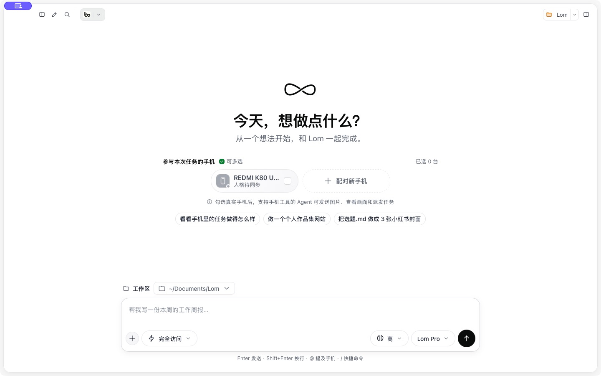
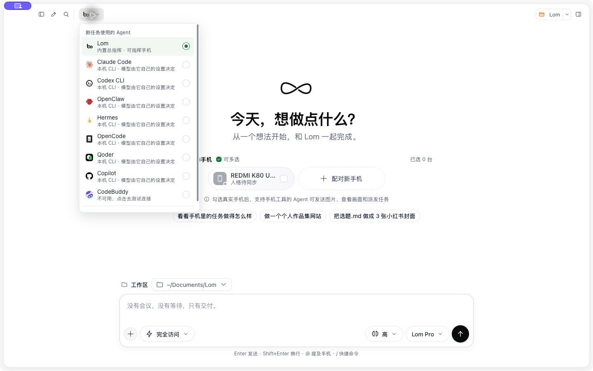

<p align="center"></p>

<h1 align="center">麓鸣 Lom</h1>
<p align="center">把模型、Agent、工具和手机，放进同一个工作台。</p>
<p align="center"><a href="README.md">English</a> · <a href="https://lom-cn.heang.top/">官方产品</a> · <a href="https://github.com/rfdiosuao/lom-desktop/releases">下载社区版</a> · <a href="BUILDING.md">自行构建</a> · <a href="https://github.com/rfdiosuao/lom-desktop/issues">反馈问题</a></p>

选一个工作文件夹，接上自己的模型或本机 Agent，就可以在麓鸣里对话、调用工具、查看文件改动，也能把多个 Agent 组成团队一起工作。

这里是 **Lom 社区版**：桌面客户端、Rust 本地执行内核、Android 源码和设备协议。默认不连接麓鸣官方云服务。商业账号、积分订阅、模型网关、手机云中转及运营后台不在这个仓库中。

<p align="center">
<a href="https://github.com/rfdiosuao/lom-desktop/releases"></a>
<a href="LICENSE"></a>
<a href="https://github.com/rfdiosuao/lom-desktop/stargazers"></a>
</p>

<p align="center"></p>

截图来自麓鸣官方桌面版；社区版包含的能力与服务依赖见下文。

## 可以做什么

- **使用自己的模型和 Agent**：配置模型服务的 API Key，或接入已安装的本机 Agent CLI。外部 CLI 需要自行安装、登录，麓鸣会检测本机的实际可用状态。
- **在一个工作台里干活**：对话、工作区、文件改动、工具调用、历史和权限集中展示，按真实状态反馈执行结果。
- **管理工具与角色**：配置 MCP、使用本地技能和智能体模板。可选接入自行部署的 Activepieces；社区版不预填维护者的连接器地址。
- **组成 Agent 团队**：第一个加入的电脑 Agent 担任主控，可在并排、看板、单个和群聊视图里查看协作。
- **局域网扫码配对手机**：电脑和社区 Android 配对客户端在同一私有网络内直连，RPC 使用签名加密信封。独立配对 APK 用于验证连接，**不是完整手机 Agent**。

依赖账号的 Personal Agent 功能仍需要兼容服务，客户端代码不能代替服务端。手机能做什么取决于实际连接的客户端，配对成功不代表完整手机自动化已经通过实机验证。

<p align="center"></p>

## 下载与平台状态

在 [GitHub Releases](https://github.com/rfdiosuao/lom-desktop/releases) 下载已有版本，安装前查看发布说明并核对 SHA-256。

| 平台 | 社区版分发状态 |
| --- | --- |
| macOS · Apple 芯片 | 社区桌面版 DMG |
| Android | 局域网配对验证 APK；完整 Agent 源码需要另外准备原生构建环境 |
| Windows | **暂未上线**，当前不分发 Windows 安装包与更新 |
| iPhone / iPad | 暂无 Lom 版本；保留的上游 iOS 源码不代表已支持 |

社区版使用独立的应用标识、数据目录和凭据命名空间，不读取商业桌面版的账号与用户数据。官方自动更新已关闭。

另行分发的官方产品及托管服务见[国内官网](https://lom-cn.heang.top/)与[官网文档](https://lom-cn.heang.top/docs/)。社区安装包仍从上方 GitHub Releases 获取。

## 开发与构建

桌面前端使用 Node.js 24 LTS：

```sh
git clone --recurse-submodules https://github.com/rfdiosuao/lom-desktop.git
cd lom-desktop/apps/desktop
npm ci
npm test -- --maxWorkers=2
npm run build
```

要运行完整桌面应用，还需要编译 Rust 内核并准备校验过的 Lark CLI sidecar。完整步骤、前端开发、Android 原生依赖和发布检查见 [BUILDING.md](BUILDING.md)。前端构建成功不等于完整应用已经打包或通过实机验收。

局域网配对仅用于可信私有网络：配对和控制层使用明文 HTTP，配对受一次性扫码密钥和设备令牌保护，RPC 载荷另行签名加密。不要把监听端口暴露到公网。这里没有实现公网自建中转、USB 通道或 VPN 配置。

## 源码结构与许可证

| 目录 | 内容 | 许可证 |
| --- | --- | --- |
| [`apps/desktop`](apps/desktop) | React / TypeScript 界面与 Tauri 外壳 | AGPL-3.0-only |
| [`core`](core) | 基于 AionCore 的 Rust 本地执行 API | Apache-2.0，以组件声明为准 |
| [`apps/android`](apps/android) | 基于 OpenMinis 的手机端 | GPL-3.0，保留第三方许可 |
| [`protocol`](protocol) | 设备协议、生成代码与测试向量 | MIT OR Apache-2.0 |

各程序通过协议通信，集中到同一个仓库不改变各自的许可证。感谢 AionCore / AionUi、OpenMinis、Lark CLI 及组件声明中列出的上游作者与贡献者；再分发时请保留原有署名和许可。

## 致谢

感谢 [AionUi / AionCore](https://github.com/iOfficeAI/AionUi)、[OpenMinis](https://github.com/OpenMinis/OpenMinis)、[Lark CLI](https://github.com/larksuite/cli) 及各项目贡献者；仓库内的组件继续保留原有署名与许可。

[Mika](https://github.com/wangzan101/Mika)（作者 wangzan101，[Apache-2.0](https://github.com/wangzan101/Mika/blob/main/LICENSE)）是相关的独立分发手机客户端，其源码不属于本次快照。麓鸣版与原作者发布的版本分别维护。

## 一起完善

提 Issue 时带上社区版版本号、系统、复现步骤和脱敏后的报错。不要提交 API Key、登录凭据或私人聊天记录。参与方式见 [CONTRIBUTING.md](CONTRIBUTING.md)。

源码以可审查的版本快照同步，保留社区适配层，不导入私有 Git 历史、用户数据或签名密钥，也不预填生产服务地址。发布前同时检查工作区和暂存区，并执行相应组件的测试；扫描器只输出文件路径和规则名，不输出命中的密钥值。

[同步来源](docs/SOURCE_SNAPSHOTS.md) · [开源边界](docs/OPEN_SOURCE_SCOPE.md) · [验证记录与限制](docs/VERIFICATION.md) · [手机接入协议](docs/open/phone-access/README.md)
