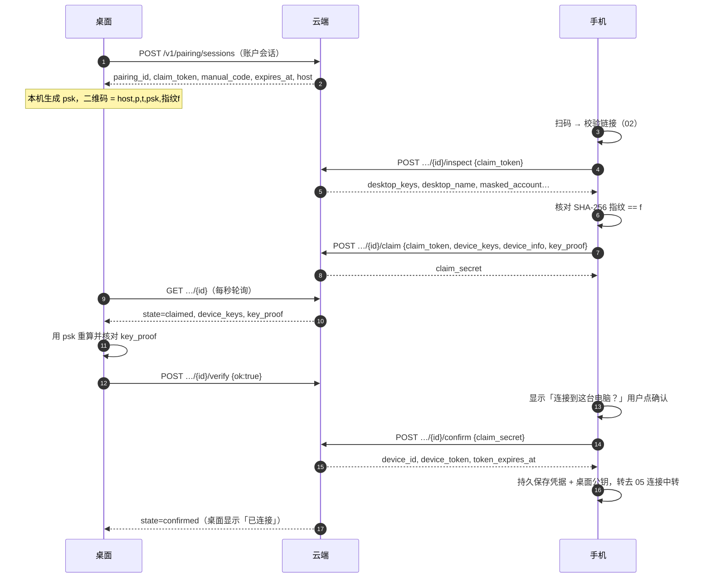

# 03 配对流程

配对的结果是：手机拿到**设备凭据**（`device_id` + `device_token`），并记下**被批准的桌面公钥**。有两条路径：

| 路径 | 适用 | 防中间人的手段 |
|---|---|---|
| **扫码路径**（推荐） | 能扫到桌面二维码 | 二维码里的 `psk` 与公钥指纹 `f`：手机核对指纹，桌面核对手机算出的 `key_proof` |
| **配对码路径** | 扫不了码 | 6 位**确认码**：两端各自根据公钥计算，用户肉眼比对 |

> 本页所有接口都由云端提供，主机名为 `lom.entermodetwo.com`（扫码路径以二维码 `h` 为准，且必须在白名单内），**只走 HTTPS**。算法细节（公钥串、指纹、`key_proof`、确认码）见 [04](04-identity.md)。

## 0. 通用约定

**请求**：`Content-Type: application/json`，UTF-8。令牌放在请求体或请求头里，**绝不放进 URL**。

**响应**：

```jsonc
// 成功
{ "success": true, "data": { /* 各接口不同 */ } }   // 部分接口没有 data，只有 {"success": true}
// 失败（HTTP 状态码见各接口 / 错误码表）
{ "success": false, "code": "pairing.expired", "error": "配对码已过期，请在电脑上刷新。" }
```

按 `code` 做逻辑判断，`error` 是给人看的中文说明（可直接展示，也可以映射成你自己的文案，见 [08 错误码表](08-errors-security.md#错误码表)）。**非 JSON 的响应（网关错误页、框架级 4xx/5xx）也要当作失败处理**，建议映射为本地错误 `pairing.response_invalid`。

**时间**：响应里的 `expires_at`、`token_expires_at` 都是 **Unix 秒**。

**建议的 HTTP 超时**：连接 10 秒、读 15 秒、整个请求 20 秒。网络层失败（无响应）统一映射为本地错误 `net.unreachable`，文案「无法连接麓鸣服务，请检查网络。」

**限流**：`inspect`、`claim`、`claim-by-code` 三个接口合计**同一 IP 每个自然分钟最多 10 次**（扫码路径一次完整认领就用掉 2 次），超出返回 HTTP 429 `pairing.rate_limited`。`confirm`、`cancel` 不按 IP 限流。

**设备信息 `device_info`**：

```json
{ "name": "我的 Pixel", "model": "Pixel 8", "os": "Android 15", "app_version": "1.2.3" }
```

四个字段都是字符串，缺省为空串；云端会去掉控制字符并截断到 64 个字符；`name` 为空时用 `model`，仍为空则显示「手机」。`name` 就是桌面上显示的设备名。

## 1. 总览时序（扫码路径）



桌面一侧的接口（创建会话、轮询状态、`verify`、作废会话）需要桌面账户会话，**手机端不会调用**，这里只列出帮助你理解状态流转。

## 2. 扫码路径（手机调用的接口）

### 2.1 `inspect` — 取桌面公钥

```
POST /v1/pairing/sessions/{pairing_id}/inspect
```

| 项 | 内容 |
|---|---|
| 鉴权 | 无；凭据是请求体里的 `claim_token` |
| 请求体 | `{ "claim_token": "<二维码 t>" }` |
| 成功 `data` | `pairing_id`（回显）、`desktop_name`、`desktop_keys`（桌面公钥串 `K`）、`masked_account`（如 `a***@example.com`）、`expires_at`（秒） |
| 前置状态 | 会话必须是 `open` |
| 超时 | 会话创建后 5 分钟过期 |

收到响应后，手机**必须**在本地完成下面的核对，任一项失败就中止，提示「配对信息不一致，请重新扫码」（本地错误码 `pairing.key_mismatch`），不要继续 `claim`：

1. `data.pairing_id` 与二维码里的 `p` 完全相等；
2. `desktop_keys` 是合法公钥串：86 字符、规范 base64url、解码后 64 字节；
3. 用 [04](04-identity.md#指纹) 的方法算出 `desktop_keys` 的指纹，与二维码里的 `f`（解码后 16 字节）**恒定时间比较**相等。

错误：`pairing.qr_invalid`（403，`claim_token` 错误；同一会话累计错 5 次，会话作废为 `failed`）、`pairing.not_found`（404）、`pairing.expired`（410）、`pairing.already_claimed`（409，已被认领）、`pairing.cancelled`（409）、`pairing.failed`（409）、`pairing.rate_limited`（429）。

### 2.2 `claim` — 认领并提交身份

```
POST /v1/pairing/sessions/{pairing_id}/claim
```

| 项 | 内容 |
|---|---|
| 鉴权 | 无；请求体带 `claim_token` |
| 请求体 | `claim_token`、`device_keys`（手机公钥串 `K`）、`device_info`（见上）、`key_proof`（见下） |
| 成功 `data` | `claim_secret`（后续 `confirm` / `cancel` 的凭据，只用一次，保存在内存即可）、`expires_at`（秒） |
| 状态变化 | `open` → `claimed` |

`key_proof` 的计算（`psk` 是二维码 `k` 解码后的 32 字节，`desktop_keys` 用 `inspect` 返回的那一个，详见 [04](04-identity.md#key_proof)）：

```
key_proof = b64url( HMAC-SHA256( key = psk,
                    msg = "LOM-PAIR-PROOF-V1\n" + pairing_id + "\n" + desktop_keys + "\n" + device_keys ) )
```

云端**不会也无法**验证 `key_proof`（它没有 `psk`），只检查它是 32 字节的规范 base64url；真正的核对在桌面。核对不过时，桌面会把会话置为 `failed`，手机下一步 `confirm` 会收到 `pairing.failed`。

其他错误：`pairing.request_invalid`（400，`device_keys` 非法、等于桌面公钥串，或 `key_proof` 长度不对）、`device.owned_by_other_account`（409，这组公钥已属于另一个账户，需先在原账户解除）、`pairing.already_claimed`（409）、以及 inspect 同款的 `qr_invalid` / `expired` / `rate_limited` 等。

### 2.3 在手机上让用户确认

`claim` 成功后，手机显示确认页：

- 标题：「连接到这台电脑？」
- 内容：`desktop_name`、`masked_account`（扫码路径**不**显示确认码）
- 按钮：「确认连接」「取消」

用户点「取消」→ 调 `cancel`（见 2.5）；用户什么都不做 → 会话 5 分钟后自行过期，确认按钮应失效（`pairing.expired`）。

### 2.4 `confirm` — 取得设备凭据

```
POST /v1/pairing/sessions/{pairing_id}/confirm
```

| 项 | 内容 |
|---|---|
| 鉴权 | 无；请求体带 `claim_secret` |
| 请求体 | `{ "claim_secret": "<claim 返回的值>" }` |
| 成功 `data` | `device_id`（形如 `dev_` + 32 位十六进制）、`device_token`（43 字符 base64url）、`token_expires_at`（秒，约 90 天后）、`desktop_name` |
| 状态变化 | 扫码路径 `verified` → `confirmed`；配对码路径 `claimed` → `confirmed` |

**扫码路径要等桌面核对完 `key_proof`**：如果手机点得比桌面快，云端返回 HTTP 409 `pairing.awaiting_desktop`，手机应**每秒重试一次，最多 15 次**；15 次后仍未通过，提示「电脑迟迟没有确认，请重新扫码」（本地错误 `pairing.desktop_timeout`）。重试期间界面保持「正在等待电脑核对」。网络失败（`net.unreachable`）可以额外重试最多 3 次。

**确认响应丢失怎么办**：如果 `confirm` 已在云端成功、但响应没到手机，用**同一个 `claim_secret`** 再调一次 `confirm`，云端会给同一台设备**重新签发**令牌（旧令牌作废），不会创建第二个设备。这个宽限期到会话过期后再 5 分钟。

**凭据落盘**：拿到响应后，手机**先把凭据持久化成功，再向用户显示「已连接」**。如果落盘失败，向用户报错（本地错误 `pairing.store_failed`），可以重新 `confirm` 取得新令牌。手机要保存的内容：

| 保存项 | 说明 |
|---|---|
| 云端主机名 | 扫码路径取二维码 `h`，配对码路径取内置默认主机 |
| `device_id`、`device_token`、`token_expires_at` | 设备凭据，**必须放进 Android Keystore 保护的存储** |
| **被批准的桌面公钥**（`desktop_keys`）与 `desktop_name` | 之后只有这些公钥发来的信封才会被接受（[06](06-rpc-envelope.md)）。官方手机端同一时刻只保留一台被批准的桌面（要换桌面须先解除配对再重新扫码）；建议你的存储结构设计成「集合」，以便将来扩展 |

其他错误：`pairing.secret_invalid`（403，`claim_secret` 不对）、`pairing.expired`（410）、`pairing.cancelled`（409）、`pairing.failed`（409，桌面核对 `key_proof` 失败）、`pairing.not_found`（404）、`device.owned_by_other_account`（409）、`sub.phone_limit`（409，该账户订阅的手机台数已满）。

### 2.5 `cancel` — 手机取消

```
POST /v1/pairing/sessions/{pairing_id}/cancel
```

请求体 `{ "claim_secret": "…" }`，成功返回 `{ "success": true }`。只在 `claimed` / `verified` 状态有效；已经 `cancelled` 时重复调用也返回成功；其他状态返回对应的状态错误。取消后桌面显示「手机已取消连接」。

### 2.6 桌面一侧（手机不调用，仅供参考）

| 接口 | 说明 |
|---|---|
| `POST /v1/pairing/sessions` | 桌面创建会话，提交 `install_id`、`desktop_name`、`desktop_keys`；返回 `pairing_id`、`claim_token`、`manual_code`、`expires_at`、`host`。同一台桌面再次创建会作废它之前未完成的会话 |
| `GET /v1/pairing/sessions/{id}` | 桌面每秒轮询：`state`、`method`（`qr` / `code`）、认领后的 `device_keys`、`device_info`、`key_proof` |
| `POST /v1/pairing/sessions/{id}/verify` | 扫码路径：桌面用本机 `psk` 重算 `key_proof` 并**恒定时间比较**后上报 `{ "ok": true/false }` |
| `DELETE /v1/pairing/sessions/{id}` | 刷新二维码或关闭弹窗时作废会话 |

## 3. 配对码路径

适用于扫不了码的情况：桌面显示 8 位配对码 `XXXX-XXXX` 和一个倒计时。

### 3.1 `claim-by-code` — 凭码认领

```
POST /v1/pairing/claim-by-code
```

| 项 | 内容 |
|---|---|
| 主机 | App 内置的默认主机（`lom.entermodetwo.com`），因为这条路径没有二维码可以取主机名 |
| 鉴权 | 无 |
| 请求体 | `manual_code`（规范化后的配对码，见 [02 §5](02-qr.md#5-配对码路径没有二维码时)）、`device_keys`、`device_info` |
| 成功 `data` | `pairing_id`、`desktop_name`、`desktop_keys`、`masked_account`、`expires_at`（秒）、`claim_secret` |
| 状态变化 | `open` → `claimed`（`method = code`） |

没有 `psk`，所以**不能**核对指纹，也没有 `key_proof`。取而代之的是确认码比对：

1. 手机校验 `desktop_keys` 是合法公钥串（86 字符、规范 base64url、64 字节）；
2. 手机**本地**计算确认码（[04](04-identity.md#确认码sas)）：`SAS(pairing_id, desktop_keys, device_keys)`；桌面用同样的公式、同样的输入在本机算出同一个数；云端不下发确认码；
3. 手机显示确认页：桌面名称、脱敏账户、**6 位确认码**（如 `482 913`），文案「请确认电脑和手机上显示的确认码一致」；
4. 用户**对照桌面屏幕**，一致才点「确认连接」→ `confirm`（同 2.4，配对码路径无需等桌面核对，`claimed` 状态即可确认）；不一致就点「取消」→ `cancel`。**不得**在用户没有明确确认的情况下自动 `confirm`。

确认码不一致意味着云端（或链路上的人）在两端展示了不同的公钥——这正是它存在的理由。

错误：`pairing.code_invalid`（400，配对码格式不对、不存在、已过期或已被认领——对外不区分，防止枚举）、`pairing.rate_limited`（429，只按 IP 限流，同一 IP 每分钟 10 次；配对码路径按 IP 而不是按会话限流）、`pairing.request_invalid`（400）、`device.owned_by_other_account`（409）。

## 4. 会话状态机（云端）

| 当前状态 | 事件 | 下一状态 |
|---|---|---|
| — | 桌面创建 | `open` |
| `open` | 手机认领成功 | `claimed` |
| `open` | 过期 / 桌面刷新或关闭 | `expired` / `cancelled`（终态） |
| `claimed`（扫码） | 桌面核对 `key_proof` 通过 | `verified` |
| `claimed`（扫码） | 桌面核对失败 | `failed`（终态） |
| `claimed`（配对码）/ `verified`（扫码） | 手机确认 | `confirmed`（终态） |
| `claimed` / `verified` | 手机取消 / 过期 | `cancelled` / `expired`（终态） |
| 任意存活状态 | 同一会话 `claim_token` 累计错 5 次 | `failed`（终态） |

手机本地的配对状态机：`unpaired` → `pairing` → `paired`；`paired` →（用户解除配对，或凭据被吊销）→ `unpaired`。**已配对时再发起配对，应先要求用户解除当前配对**（本地错误 `pairing.already_paired`）；一台手机同一时刻只属于一个账户。

## 5. 解除配对

手机主动解除：

```
DELETE /v1/devices/me
Authorization: Device <device_id>.<device_token>
```

成功返回 `{ "success": true }`；云端同时作废设备凭据并关闭该手机的 WebSocket。手机随后清除设备凭据与所有桌面公钥，回到 `unpaired`。**手机上的会话、技能、人格、记忆保留**，不删除。

桌面主动移除手机时，云端会向仍在线的手机推送 `device.revoked`（见 [05](05-relay.md#6-被撤销)），离线的手机下次换令牌时会收到 `relay.device_revoked`。两者的处理相同：清除凭据与桌面公钥，回到 `unpaired`。

## 6. 超时与失败总表

| 环节 | 限制 | 超出后 |
|---|---|---|
| 会话有效期 | 创建后 5 分钟 | `pairing.expired`（410）；桌面需刷新二维码 |
| 同一会话 `claim_token` 错误 | 累计 5 次 | 会话作废，`pairing.failed` |
| 认领类接口限流 | 同一 IP 每分钟 10 次（`inspect`+`claim`+`claim-by-code`） | `pairing.rate_limited`（429），等下一分钟 |
| `awaiting_desktop` 重试 | 每秒 1 次，最多 15 次 | 本地 `pairing.desktop_timeout`，让用户重新扫码 |
| 重复 `confirm` 宽限（仅限已经确认成功的会话） | 会话过期后再 5 分钟 | 之后返回 `pairing.already_claimed`（409）；此时设备已在云端建立但手机没拿到令牌，重新扫码配对即可（同一账户、同一组公钥会沿用原 `device_id`，旧凭据作废） |
| 设备凭据有效期 | 90 天，使用（换中转令牌）时滚动续期 | 超过 90 天未使用：`relay.device_revoked`，必须重新配对 |

## 7. 手机端必须满足的安全要求（配对阶段）

1. 校验二维码版本、字段长度、**主机白名单**；校验不过时不发任何网络请求；
2. 扫码路径**必须**核对桌面公钥指纹；配对码路径**必须**让用户比对确认码；
3. 用户**明确点击**之后才 `confirm`，深链进来的配对也不例外；
4. `psk`、`claim_token`、`claim_secret`、`device_token` 不进日志、不进 URL、不进崩溃报告；
5. 设备凭据与身份私钥放进 Keystore 保护的存储；
6. 所有令牌 / 指纹 / `key_proof` 的比较用恒定时间比较；
7. 只信任配对时批准的桌面公钥，不要根据云端设备列表或其他来源追加信任。
