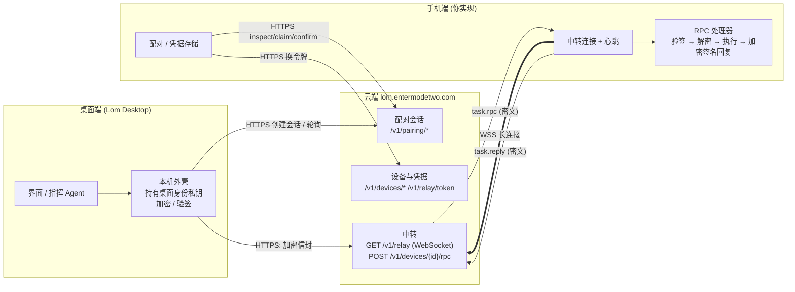

# 麓鸣 Lom 手机端接入协议（第三方开发者文档）

本目录是写给**第三方手机端开发者**的公开文档：读完它，你不需要接触任何私有仓库或源码，就能做出一个可以被「麓鸣 Lom」桌面端扫码配对、并接受桌面派活的手机 App。文档中的每个算法都配有测试向量（见 [testvectors/](testvectors/)），可以先用向量自测，再去联调。

> 文档依据：2026-11 的线上云端、桌面端 0.3.x 与官方手机端的实际行为。**与早期设计稿（R01/R02 规格）不一致的地方，一律以实际行为为准**，差异见本文末尾「与早期设计稿的差异」。

## 阅读顺序

| 文件 | 内容 |
|---|---|
| 本页 | 概览、术语、连接拓扑、实现清单、常见误解 |
| [02-qr.md](02-qr.md) | 二维码 / 深链 `lom://pair` 的逐字段格式与校验 |
| [03-pairing.md](03-pairing.md) | 配对全流程：扫码路径与配对码路径，每一步的请求、响应、错误码、超时 |
| [04-identity.md](04-identity.md) | 身份密钥、编码规则、指纹 / `key_proof` / 确认码的精确算法 |
| [05-relay.md](05-relay.md) | 设备凭据、中转令牌、WebSocket、心跳、重连、被撤销 |
| [06-rpc-envelope.md](06-rpc-envelope.md) | 桌面 → 手机的加密签名信封：字段、加解密与验签步骤、重放保护 |
| [07-methods.md](07-methods.md) | 手机要实现的 RPC 方法清单（必需 / 可选），逐个写请求与响应 |
| [08-errors-security.md](08-errors-security.md) | 错误码表、版本与兼容策略、安全注意事项 |
| [testvectors/](testvectors/) | 两份测试向量 + 自测脚本 |

## 1. 概览

「麓鸣 Lom」是一个桌面 Agent 工作台。用户在桌面端点「添加手机 → 扫一扫」，用手机 App 扫描屏幕上的二维码，在手机上点「确认连接」，这台手机就成了该账户下的一个独立 Agent。之后桌面可以：

- 把桌面当前选中的模型配置同步给手机（`model.sync`），
- 给手机发消息、读取手机上的会话进度、停止任务（`chat.*`），
- 同步手机上的人格 / 记忆文档、定时任务、技能、子代理，
- 传文件、取手机截图、读界面树、代为点按（`file.*`、`screen.*`）。

手机端**不需要登录账号**，也**不需要和电脑在同一个网络**：手机主动连到云端中转，桌面的请求由云端原样转给手机，云端看不到请求内容（请求是端到端加密 + 签名的信封）。

作为第三方，你要实现的就是手机端的三件事：

1. **配对**：解析二维码（或输入配对码），与云端完成认领与确认，拿到设备凭据；
2. **保持在线**：用设备凭据换中转令牌，连上 WebSocket，维持心跳与重连；
3. **响应 RPC**：收到桌面发来的加密信封，验签、解密、执行方法、把结果加密签名后回给云端。

### 术语

| 术语 | 含义 |
|---|---|
| 桌面 / 电脑 | 运行 Lom 的桌面应用，已登录麓鸣账户 |
| 手机端 | 你要实现的 App；本文也叫「手机」 |
| 云端 | 麓鸣云端服务，公开主机名 `lom.entermodetwo.com`；负责配对会话、设备凭据、WebSocket 中转 |
| `pairing_id` | 配对会话 ID，16 字节随机数的 base64url（22 字符） |
| `claim_token` | 认领令牌，32 字节随机数的 base64url（43 字符），云端只存哈希 |
| `psk` | 预共享密钥，32 字节，**只出现在二维码里**，从不发给云端 |
| 配对码 `manual_code` | 8 位人工输入码，形如 `AB3D-9XK2`，扫不了码时的备选路径 |
| 公钥串 `K` | `b64url(x25519 公钥 32 字节 ‖ ed25519 公钥 32 字节)`，86 字符；桌面和手机各有一个 |
| 指纹 | `SHA-256("LOM-KEY-FP-V1\n" + K)` 的前 16 字节 |
| `key_proof` | 扫码路径里手机用 `psk` 对两端公钥算出的 HMAC，证明「我扫了这个二维码」 |
| 确认码（SAS） | 配对码路径里两端各自算出的 6 位数字，由用户肉眼比对 |
| `claim_secret` | 认领成功后云端发给手机的一次性凭据，用于「确认 / 取消」 |
| 设备凭据 | `device_id` + `device_token`，请求头 `Authorization: Device <device_id>.<device_token>`，90 天滚动续期 |
| 中转令牌 `relay_token` | 用设备凭据换来的 1 小时令牌，只用于连接 WebSocket |
| 信封 Envelope | 桌面 ↔ 手机之间的加密 + 签名消息，六个字符串字段 |
| RPC 方法 | 信封里的 `method`，例如 `chat.send`；手机必须实现的功能单位 |

### 连接拓扑



要点：

- 手机**只向外连**，不监听任何端口；
- 云端**不解析**信封内容，只做「账户归属校验 + 转发 + 15 秒等回复」；
- 配对时桌面与手机交换的公钥（`K`）就是之后加密、验签用的身份，**换密钥必须重新配对**；
- 一台手机同一时刻只属于一个账户，官方手机端一次只配对一台桌面（换桌面需先解除配对再重新扫码）；一个账户可以有多台手机。

### 一次完整接入的时间线

```text
1  桌面：创建配对会话，本机生成 psk，显示二维码（5 分钟有效）
2  手机：扫码 → 解析校验 → inspect（取桌面公钥，核对指纹 f）→ claim（带 key_proof）
3  桌面：核对 key_proof → verify
4  手机：用户点「确认连接」→ confirm → 拿到 device_id / device_token，保存桌面公钥
5  手机：POST /v1/relay/token → GET wss://…/v1/relay（保持在线）
6  桌面：POST /v1/devices/{id}/rpc  ──密文信封──▶  手机 task.rpc
7  手机：验签、解密、执行 ──────────────密文信封──▶  task.reply → 桌面
```

### 实现清单（建议按此顺序做，每步都可以用向量或联调验证）

1. base64url（无填充、规范编码）工具，生成并持久保存 X25519 + Ed25519 身份密钥（[04](04-identity.md)）；
2. 用 [testvectors/verify.py](testvectors/verify.py) 的算法对照，实现并跑通 `pairing-v1.json`（指纹、`key_proof`、确认码、二维码）；
3. 二维码解析与校验（[02](02-qr.md)）；
4. 配对：inspect → claim → confirm，处理全部错误码（[03](03-pairing.md)）；
5. 设备凭据安全存储、换中转令牌、WebSocket、心跳、重连、`device.revoked`（[05](05-relay.md)）；
6. 信封验签 / 解密 / 加密 / 签名，跑通 `remote-envelope-v1.json`（[06](06-rpc-envelope.md)）；
7. 重放保护、时间窗口、统一错误回复（[06](06-rpc-envelope.md)）；
8. 先实现必需方法（`model.sync`、`chat.*`、`document.list/read`、`schedule.list`），其余方法对不支持的返回 `remote.method_unknown`；建议再实现 `device.capabilities` 声明自己支持的方法（[07](07-methods.md)）。

### 常见误解

- **「桌面通过 MCP 的 15 个工具驱动手机」——不对。** 桌面里确实有一座 MCP 桥（`phone_screenshot`、`phone_task_start` 等工具），但它是桌面**给自己的指挥 Agent 用的本机桥**，不对外，也不经过云端。指挥 Agent 调用这些工具时，桌面把它们翻译成对手机的 RPC 调用。**手机要实现的是 [07-methods.md](07-methods.md) 里的 RPC 方法，不是 MCP。** 对应关系（供理解用）：

  | 桌面指挥 Agent 的工具 | 实际发给手机的 RPC |
  |---|---|
  | `phone_status` | `device.status` |
  | `phone_apps` | `apps.list` |
  | `phone_screenshot` | `screen.capture` |
  | `phone_ui_tree` | `screen.tree` |
  | `phone_control` | `screen.control` |
  | `phone_task_start` | 通常先 `model.sync` 再 `chat.send` |
  | `phone_task_read` | `chat.read` |
  | `phone_task_cancel` | `chat.cancel` |
  | `phone_send_image` | `file.begin` / `file.chunk` / `file.finish`，可选 `file.save_gallery` |
  | `phone_list`、`lom_view_image`、`agent_*` | 只在桌面本机完成，不涉及手机 |

- **「手机和电脑要在同一个局域网」——不需要。** 官方路径经云端中转，4G 也可以。（社区版另有局域网直连模式，见下节。）
- **「中转用了 Noise 协议」——当前没有。** 早期设计稿写过 Noise IK，现行实现是「X25519 → HKDF → ChaCha20-Poly1305 + Ed25519 签名」的一次性信封（[06](06-rpc-envelope.md)）。

### 官方云端模式与社区局域网模式

本文档描述的是**官方云端模式**（手机连 `wss://lom.entermodetwo.com/v1/relay`）。公开仓库的 [`protocol/docs/LAN-PAIR-01.md`](../../../protocol/docs/LAN-PAIR-01.md) 描述的是社区版桌面的**局域网直连模式**：二维码里 `h` 是 `内网IP:端口`，配对三步（inspect / claim / confirm）与本文相同，身份密钥、指纹、`key_proof`、RPC 信封与方法清单**完全复用**，区别只在传输：手机每 800 ms 轮询桌面而不是连 WebSocket。若你只做局域网模式，本文的 02、03（扫码路径）、04、06、07 同样适用，05 不适用；局域网模式的传输细节以 LAN-PAIR-01.md 为准（本文未逐项核对）。云端中转服务不在本仓库内，本文不涉及自建云端。

### 约定

- 所有 JSON 字段名为 `snake_case`；时间戳除特别说明外为 **Unix 秒**（云端返回的 `expires_at` 等）或 **Unix 毫秒**（信封里的 `issued_at`、会话消息时间）——每处都会写明；
- 云端 HTTP 接口统一返回 `{"success": true, "data": {...}}` 或 `{"success": false, "code": "<域>.<原因>", "error": "<中文说明>"}`；
- 本文里「必须」「不得」表示不遵守会导致互操作失败或安全问题，「建议」表示推荐做法。

## 与早期设计稿的差异（以实际行为为准）

早期内部设计稿（R01 配对、R02 中转）与现行实现不同的地方，第三方请按**本文档**实现：

| 早期设计稿 | 实际行为 |
|---|---|
| 端到端通道用 Noise IK 握手（`Noise_IK_25519_ChaChaPoly_BLAKE2s`），消息带递增 nonce | **没有 Noise。** 每个请求 / 回复是独立的「临时 X25519 + HKDF-SHA256 + ChaCha20-Poly1305 + Ed25519 签名」信封；重放靠 `issued_at` 窗口 + 信封 ID 去重（[06](06-rpc-envelope.md)） |
| 中转帧 `{v,to,from,id,kind,body}`，`ack`、离线队列、按序重发 | **没有。** 中转只转发 `task.rpc` / `task.reply` 两种文本消息和少量 `ctrl` 控制消息；手机离线时桌面请求立刻失败（`relay.offline`），云端不排队 |
| 客户端每 20 秒发心跳，60 秒收不到数据判定断线 | 云端每 20 秒发 WebSocket Ping，60 秒内没从客户端收到任何帧就断开；客户端要么自动回 Pong，要么也自己每 20 秒发 Ping（[05](05-relay.md)） |
| 中转令牌到期前 5 分钟在连接内续期 | **没有连接内续期。** 令牌只在握手时校验；每次（重）连接前重新 `POST /v1/relay/token`（[05](05-relay.md)） |
| 手机用 FCM 推送唤醒 | 云端与桌面都不依赖推送；保活策略由手机端自己决定（官方手机端用前台服务 + 重连） |
| 配对码路径由云端下发确认码 | 确认码由两端各自根据公钥计算，云端不下发（与设计稿 §2.8 一致，列出以防混淆） |
